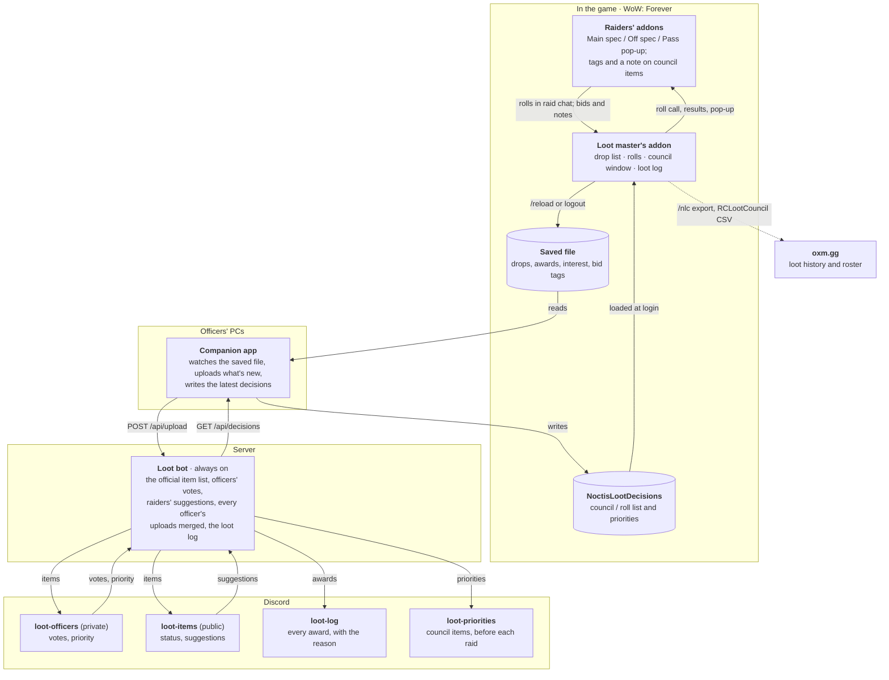

# Noctis Loot

The Noctis guild's loot system for WoW: Forever: loot rolls and a loot council in game, decisions and the loot log in Discord. Three programs, one repo, each packaged for the people who use it:

| | Folder | Who gets it | How |
|---|---|---|---|
| **Noctis Loot Council**, the addon (`/nlc`) | [`addon/`](addon/README.md) | everyone in the raid | CurseForge zip: `python tools/package.py addon` |
| **The companion app** | `companion/` | officers, on their Windows PCs | `NoctisLootCompanion.exe` from [Releases](../../releases), built by GitHub Actions |
| **The loot bot** | `bot/` | the server | `docker compose up -d --build` (below) |

- The **addon** runs the rolls and the council in game and keeps the list of raid drops; its README is the player's guide.
- The **loot bot**, always on, keeps the official item list, runs the officers' votes in Discord and posts the loot log. It also serves a small HTTP API.
- The **companion app**, a small window and a tray icon, uploads what the addon saw in the raid and writes the latest decisions where the game can load them.

### How it hangs together

The game can't reach the internet, so data moves through files: the companion app carries it between the addon's files and the bot, and the bot keeps the official list and talks to Discord.



Rolls work from raid chat alone: raiders without the addon type `/roll` or `/roll 99`, and the pop-up is a shortcut on top. Bid tags and notes need the addon and go only to the loot master and the council.

The exact file and API formats are in [`docs/sync-format.md`](docs/sync-format.md). A change to them changes the addon and the bot together, in one commit.

### The weekly flow

1. **Between raids, in Discord.** An officer posts a known item with `/loot add`. In the private **#loot-officers** channel officers vote **Council** or **Roll** and set a priority ("Warlock priority"); an option wins once it has 3 votes (and more than the other). To discuss an item, an officer starts a thread on its post (Discord's own Create Thread). In the public **#loot-items** channel raiders see every item's status and can press **Suggest for council**; officers see who suggested it, and it never changes anything by itself. Each post shows the item's icon and links to its Wowhead page (Forever's when Wowhead has it). Items seen on Wowhead or in other guilds' raids can go on the list before they drop for us (`/loot add` with a link, `/loot import`); raiders see those behind a spoiler.
2. **Before the raid.** An officer runs `/loot priorities`: the council items and their priorities go to **#loot-priorities**. The companion app has already written the latest decisions into the game's AddOns folder; the loot master types `/reload` and the addon says "Decisions from 27 Oct, 18:40: 34 council, 112 roll."
3. **In the raid.** The addon applies the decisions. Items nobody has decided are rolled.
4. **After the raid.** The loot master logs out or types `/reload`. The companion app uploads the night. The bot posts the awards to **#loot-log** (one post per raid and night) and every item that dropped for the first time to **#loot-officers** ("NEW IN OUR RAID LAST NIGHT", who won it, how many wanted it) and **#loot-items**, for a vote.

Decisions made in Discord always win. A decision set in game (`/nlc council ...`) is used only for items Discord hasn't decided, and is shown as "Set in game by *character*".

---

## Setting up the bot

### 1. Create the Discord application

1. Go to https://discord.com/developers/applications, **New Application**, name it "Noctis Loot".
2. **Bot** tab: **Reset Token** and copy the token (it goes in `.env` as `DISCORD_TOKEN`). No privileged intents are needed.
3. **OAuth2 → URL Generator**: scopes **`bot`** and **`applications.commands`**; bot permissions **View Channels, Send Messages, Embed Links, Read Message History**. (Manage Messages isn't needed: the bot only edits its own posts.) Open the generated link and add the bot to the server. The same link by hand, with your application ID:
   `https://discord.com/oauth2/authorize?client_id=APPLICATION_ID&scope=bot+applications.commands&permissions=84992`

### 2. Channels and the officer role

- Create **#loot-officers** (private: officers only), **#loot-items**, **#loot-priorities** and **#loot-log**. Give the bot access to the private channel (channel settings → Permissions → add the bot's role with View Channel, Send Messages, Embed Links, Read Message History).
- Only members with the officer role can vote, set priorities and use the officer commands (server admins without the role can't vote).
- Suggested pinned post for #loot-items (post and pin it yourself), from the mockup:
  > The officers decide which items are council items. If you think a roll item matters enough to be councilled, press **Suggest for council**. It's counted for the officers' next look at the list and never changes anything during a raid.

### 3. Configure

Copy `.env.example` to `.env` and fill it in. Turn on Developer Mode in Discord (Settings → Advanced) to copy IDs with a right-click.

| Setting | |
|---|---|
| `DISCORD_TOKEN` | the bot token |
| `GUILD_ID` | your server's ID |
| `OFFICER_ROLE_ID` | the officers' role |
| `CHANNEL_LOOT_OFFICERS`, `CHANNEL_LOOT_ITEMS`, `CHANNEL_LOOT_PRIORITIES`, `CHANNEL_LOOT_LOG` | channel IDs |
| `API_HOST`, `API_PORT` | where the API listens (default `127.0.0.1:8080`) |
| `VOTES_TO_DECIDE` | votes an option needs (default 3) |
| `DB_PATH` | the SQLite database (default `data/noctis-loot.db`) |
| `WCL_CLIENT_ID`, `WCL_CLIENT_SECRET` | optional, for `/loot wcl`: a client from warcraftlogs.com → API clients (any redirect URL, not a public client) |
| `TIMEZONE` | for raid nights and dates in posts (default `Europe/London`; a raid night runs until 06:00) |

### 4. Run it

**Docker (recommended).** The server doesn't need git: `python tools/package.py bot` makes `dist/NoctisLootBot.zip`, a `NoctisLootBot` folder with just what Docker needs and a short README. Unpack it on the server, fill in `.env` there, then in that folder:

```sh
docker compose up -d --build
docker compose logs -f
```

To update, unpack a new zip over the folder (it never contains a `.env`, so yours stays) and run the same command. The database lives in the `noctis-loot_loot-data` volume, which `docker compose down` keeps (`down -v` would delete it). The API is published on the host's `127.0.0.1:8080` only, for the reverse proxy or tunnel. Anything for one server only, such as another host port, goes in a `docker-compose.override.yml` next to the compose file; git ignores it, like `.env`.

On Windows with Docker Desktop, Docker only runs while a user is signed in: turn on "Start Docker Desktop when you sign in" and make sure that account signs in after a reboot.

**systemd instead.** See the instructions at the top of [`deploy/noctis-loot-bot.service`](deploy/noctis-loot-bot.service): a venv in `/opt/noctis-loot-bot`, a `noctis` system user, `API_HOST=127.0.0.1`.

**By hand** (Python 3.11): `pip install -r requirements.txt`, then `python -m bot`.

Slash commands are registered on your server at start-up, so they appear straight away.

### 5. Put the API behind your reverse proxy

The companion apps reach the bot over the internet, so put the API behind the existing reverse proxy with HTTPS (the token is a password). Only `/api/` needs forwarding; uploads can reach a few MB late in a season.

Caddy:

```
loot.example.org {
    reverse_proxy /api/* 127.0.0.1:8080
}
```

nginx (inside the `server` block that already has your certificate):

```nginx
location /api/ {
    proxy_pass http://127.0.0.1:8080;
    proxy_set_header Host $host;
    proxy_set_header X-Forwarded-For $proxy_add_x_forwarded_for;
    client_max_body_size 32m;
}
```

Check it from outside: `https://loot.example.org/api/health` should answer `{"ok": true}`. The companion app's "bot address" is then `https://loot.example.org`.

**No reverse proxy yet, and 443 reaches the host** (even if 80 is taken or blocked): run the stock `caddy` image next to the bot in a `docker-compose.override.yml`, publishing 443, with the Caddyfile below minus the `dns` and `propagation_*` lines and with `issuer acme { disable_http_challenge }` in the `tls` block. Let's Encrypt then checks the host on 443 itself (the TLS-ALPN challenge), and the bot address is `https://loot.example.org`.

**Your ISP blocks incoming 80 and 443** (some home connections do): run Caddy next to the bot in a `docker-compose.override.yml`, on another port, and get the certificate by Let's Encrypt's DNS challenge, which needs no incoming connection. If your DNS host has no API Caddy supports, delegate just the challenge to Duck DNS: build Caddy with `xcaddy build --with github.com/caddy-dns/duckdns`, add a CNAME from `_acme-challenge.loot.example.org` to a free `something.duckdns.org`, forward the router's port 8443 to the host's 443, and use:

```
loot.example.org {
	tls {
		dns duckdns {$DUCKDNS_TOKEN} {
			override_domain {$DUCKDNS_DOMAIN}
		}
		propagation_delay 30s
		propagation_timeout -1
	}
	handle /api/* {
		reverse_proxy bot:8080
	}
	handle {
		respond 404
	}
}
```

The bot address is then `https://loot.example.org:8443`. Keep the Duck DNS token in an env file next to the override, out of git like `.env`.

### Backups

Everything is in the one SQLite file. A consistent copy while the bot runs: `sqlite3 data/noctis-loot.db ".backup backup.db"` (Docker: `docker compose exec bot python -c "import sqlite3; sqlite3.connect('/data/noctis-loot.db').backup(sqlite3.connect('/data/backup.db'))"`).

---

## Using it in Discord

| | Who | |
|---|---|---|
| `/loot add <item> [name] [slot] [source] [quality] [found]` | officers | Puts an item on the list and posts it to #loot-officers and #loot-items. `item` is a Wowhead link, an in-game link or the item ID; the name, slot and quality come from Wowhead's Forever data (Classic's when Forever's doesn't have it), or type the name if Wowhead doesn't know the item. Slot ("Waist · Cloth") and source ("Molten Core, Gehennas") are optional text. `found` says where an item that hasn't dropped for us was seen (Wowhead, another guild's raid). Using it again on the same item updates the details. |
| `/loot import [text] [file] [found]` | officers | Puts items found outside our raids on the list, so they can be decided before they drop for us. Paste Wowhead links, in-game links or IDs in `text`, or attach another guild's RCLootCouncil or oxm.gg CSV export in `file` (their item IDs, raids and bosses are used; who won is not). Just for you, it first shows what it would add, with **Import** and **Cancel**. Items already on the list are left alone, except that one without a source gets the CSV's. |
| **Council** / **Roll** buttons | officers | One vote each, press the other button to change it. Decided once an option has `VOTES_TO_DECIDE` votes and more than the other. |
| **Set priority** button | officers | A short text such as "Warlock priority", shown in #loot-items, #loot-priorities and in game. Empty clears it. |
| **Suggest for council** button | everyone | On roll and undecided items in #loot-items. Press again to take it back. |
| `/loot priorities [raid] [day]` | officers | Posts the council items and priorities to #loot-priorities, then the paragraph about everything else being rolled. `day` is the heading ("Thursday 30 Oct"; default today). |
| `/loot status [item]` | everyone | Just for you: what's decided, or one item. |
| `/loot token` | officers | Just for you: a token for the companion app. Running it again replaces the old one. |
| `/loot wcl <link>` | officers | Links a Warcraft Logs report to its night's #loot-log post: "Warcraft Logs" under the heading, and each boss heading to that boss's kill (the last one before its loot went out). The post that takes it is the one on the report's night whose loot falls in the report's time; a report linked before the upload is used once the loot comes. Linking another report that holds that night's loot replaces it. The report must be public or unlisted. Needs `WCL_CLIENT_ID` and `WCL_CLIENT_SECRET`. |

The posts are edited in place as votes, priorities, suggestions and uploads change things; restarting the bot never reposts. If a post is deleted, the bot posts it again on the next change.

An item that hasn't dropped for us yet is behind a spoiler on #loot-items and #loot-priorities (its name, picture and details; tap to see them), for raiders who'd rather not see loot before it drops. Its status, priority and Suggest button stay visible. The officers' post shows it plainly, with where it was found. The spoiler goes once it drops in our raid.

---

## For officers: the companion app

A small window, and an owl in the tray by the clock. It checks the addon's saved file every 30 seconds, uploads it when it changes, and keeps the decisions addon up to date. Closing the window keeps it running in the tray; **Quit** is in the tray icon's menu.

**Install:** download `NoctisLootCompanion.exe` from the [latest release](../../releases/latest), put it in a folder of its own (its settings and log go beside it) and run it. It needs Windows 10 or 11: the window is Windows' own WebView2. The `.exe` isn't code-signed, so Windows may say it "protected your PC": **More info**, then **Run anyway**. [Checking the .exe](#checking-the-exe) shows how to make sure it's the one built from this code.

The first run asks for three things, then **Connect** checks them with the bot before saving:

1. **The WoW: Forever folder.** It suggests one it found, usually `C:\Program Files (x86)\World of Warcraft\_forever_`; **Browse…** picks another.
2. **The bot address**, e.g. `https://loot.example.org`. Your guild's release fills it in; otherwise ask whoever runs the bot.
3. **Your token**: type `/loot token` in Discord and paste it.

**Start with Windows**, on unless you untick it, starts it in the tray when you sign in.

The window then shows whether it's connected to the bot, the last upload, which decisions the game has, the folder it watches and what it's done lately. **Upload now** sends the saved file again straight away, and the gear opens the settings. The tray icon pops up a notification when it uploads something new, when it writes new decisions, and when it needs a new token. If `/loot token` is used again for your Discord account, the old token stops working: the window turns red and asks for the new one. Uploads wait until then; nothing is lost.

It keeps its settings and token in `companion.ini`, and its log in `companion.log`, next to the app (or in `%APPDATA%\NoctisLoot\` if that folder isn't writable). Starting it again while it runs brings up the window of the copy that's running.

**From the code:** install Python 3.11 from python.org, download this project, and in its folder run `python -m pip install -r requirements-companion.txt`, then `python -m companion`. Without those packages, or with `--console`, it runs in the console instead and asks its questions there; `--setup` asks them again, and `--once` does one pass and exits.

What it does each pass:

- For every `WTF\Account\*\SavedVariables\NoctisLootCouncil.lua` that changed since it last uploaded: reads it and sends it to the bot. (The game writes it at `/reload` and logout.)
- Fetches the decisions, and if they changed, writes `Interface\AddOns\NoctisLootDecisions\` (two `.toc` files and `Decisions.lua`). The game loads it at the next `/reload` or login. It shows in the AddOns list as "Noctis Loot Decisions"; leave it enabled.

### What it reads, writes and sends

All of it is in a few short files: `companion/savedfile.py` (what it takes from the saved file), `companion/client.py` (the only part that talks to the network), and `companion/ui.py` with `companion/page.html` (the window). A test, `tests/companion/test_what_it_touches.py`, fails if:

- any part but `client.py` imports networking;
- any part but `ui.py` uses code from outside Python's standard library (the window uses pywebview, pystray and Pillow, at the versions pinned in `requirements-companion.txt`);
- it starts other programs or runs code it's given;
- the window's page could load anything from the internet.

It **reads**:

- `WTF\Account\*\SavedVariables\NoctisLootCouncil.lua`, the addon's saved file, for each account on the PC. Nothing else in the game folder.
- At setup only: whether WoW is in the usual folders, and where Battle.net installed it (from the registry), to suggest the `_forever_` folder.

It **writes**:

- `Interface\AddOns\NoctisLootDecisions\` (two `.toc` files and `Decisions.lua`). Nothing else in the game folder.
- `companion.ini` (your settings and token) and `companion.log`, next to the app or in `%APPDATA%\NoctisLoot\`, with `companion.lock` and `companion.show` beside them, which keep it to one copy.
- With **Start with Windows** on: one value, `Noctis Loot companion`, under `HKEY_CURRENT_USER\Software\Microsoft\Windows\CurrentVersion\Run`, which starts it in the tray at sign-in. Turning it off removes the value.

It **talks to** the bot address in `companion.ini`, and nowhere else:

- `POST /api/upload`, with what the saved file holds about raid loot: the items (name, link, quality, where and when they dropped, the decision and note), the drops it saw and the awards (who won what, their class, how, the roll, the note and bid tags), and the name of the character that uploaded. The account folder's name stays on your PC.
- `GET /api/decisions`: the council and roll decisions.

Both carry your token. It tells the bot the upload is yours, and does nothing else: the bot accepts it for those two requests only, and it gives no access to your Discord or Battle.net account. `/loot token` replaces it.

The window loads nothing: its page, pictures and font are inside the app, shown by WebView2 in private mode (no cookies or history kept), and the page's Content-Security-Policy refuses to load anything from anywhere. There's no auto-update and no analytics. A new version is a new download, when you choose. To see the connections for yourself, Resource Monitor's Network tab (or Sysinternals TCPView) shows it connecting to the bot alone.

### Checking the .exe

The released `.exe` isn't built on anyone's PC. GitHub Actions builds it from the commit a release's tag points at, after the companion's tests pass (`.github/workflows/companion-release.yml`), and publishes it on the Releases page. Two checks:

- **Your download is the released file.** In PowerShell, in the folder you saved it to, `Get-FileHash NoctisLootCompanion.exe` should print the SHA-256 shown on the release (also in its `SHA256SUMS.txt`).
- **The released file was built from this code.** GitHub signs a build provenance for each `.exe`, naming the repository, the commit and the workflow. With the [GitHub CLI](https://cli.github.com), `gh attestation verify NoctisLootCompanion.exe -R <owner>/<repository>` (as in this repository's address) prints them, and fails if the file was changed after GitHub built it. The release notes give the exact command.

The one thing in the `.exe` that isn't in the code is the bot address it fills in at setup, if the repository's `COMPANION_BOT_URL` setting has one. Setup shows it, and you can change it.

**Building it yourself:** `python -m pip install -r requirements-dev.txt`, then `python tools/package.py companion` builds `dist\NoctisLootCompanion.exe`. To fill in your bot's address for your officers (they can still change it), first create `companion\_guild.py` with one line, `BOT_URL = "https://loot.example.org"`; git ignores that file.

---

## Trying it without Discord

```
python -m bot --new-token "Test"     # prints a token
python -m bot --api-only             # just the API on 127.0.0.1:8080
python -m companion                  # bot address http://127.0.0.1:8080, the token above
```

## Development

```
python -m pip install -r requirements-dev.txt
python -m pytest                          # the bot, the companion and the harness (below)
cd addon && luajit tests/run.lua          # the addon, against a fake WoW: Forever client
python tools/package.py all               # dist/: the addon zip, NoctisLootCompanion.exe, NoctisLootBot.zip
python addon/tools/install_dev.py "<WoW>\_forever_"   # a dev copy of the addon in game
```

**Releasing the companion:** set `__version__` in `companion/__init__.py`, commit and push, then `git tag companion-v<version>` and `git push origin companion-v<version>`. The workflow refuses a tag that doesn't match the version. Set the repository variable `COMPANION_BOT_URL` (Settings, Secrets and variables, Actions, Variables) to prefill your bot's address.

The rules (vote tally, upload merge and de-duplication, post wording) are plain modules with no Discord import (`bot/rules.py`, `bot/upload.py`, `bot/store.py`, `bot/render.py`) and are tested directly; the API is tested with aiohttp's test client against a temporary database; the poster against fake channels; the companion end to end against the real API, and what its window shows and does without a window (`tests/companion/test_controller.py`).

### The test harness

`python -m pytest` also runs the three programs together, with Discord and the game faked (`harness/`, `tests/harness/`):

- **A fake Discord** (`harness/fake_discord.py`): a local server that speaks enough of Discord's REST API and gateway for the real bot to connect to it unchanged. Tests type slash commands, press buttons and fill in forms as officers and raiders, then read what the bot posted.
- **A raid realm** (`harness/realm/`): several players, each running the real addon in its own LuaJIT process on the fake WoW: Forever client from the addon's tests. The realm passes addon messages between them, rolls their `/roll`s and keeps their clocks together. Each player has their own PC folder, so the real companion app reads their saved files and writes their decisions just as it would on an officer's PC.
- **Scenarios**: a whole week (officers decide in Discord, the companion brings it into the game, a raid night with council votes and rolls, two officers upload, the bot posts the night and the new items, next week's game knows), plus checks of each part. With `dist/NoctisLootCompanion.exe` built, one scenario runs the built app.
- **Forever's API**: `harness/forever_api.json` lists the functions and events the Forever client has (from [forever-addon-kit](https://github.com/Thunderz96/forever-addon-kit) and [forever-addon-dev](https://github.com/imperial64/forever-addon-dev), MIT). A test fails if the fake client offers, or the addon uses, one the game doesn't have. Regenerate it with `python tools/forever_api.py <forever-addon-kit> <forever-addon-dev>`.

The realm needs LuaJIT on the PATH (or in `LUAJIT`); without it those tests are skipped. The fakes are only as right as our guesses about Discord and the game: the harness proves the parts agree with each other, not that Forever behaves as the fake client does.

## Not done yet

- Nothing has run in the real game yet: WoW: Forever hasn't launched. The bot runs on the guild's Discord, and the companion app talks to it; the addon has run only against the fake game client, in the tests and the harness.
- No way to remove an item from the list or revoke a token other than issuing a new one (`/loot token` replaces the old one; deleting a row from the `tokens` table revokes it).
- Only the winner's bid tags (BIS, Sidegrade...) reach the bot, with the award; the other bidders' tags stay in game. "NEW IN OUR RAID" posts show how many wanted an item, not what they tagged.
- The CSV export for oxm.gg from the bot isn't built; the addon's `/nlc export` makes it for now.
- The addon zip builds (`python tools/package.py addon`) but isn't on CurseForge yet.
